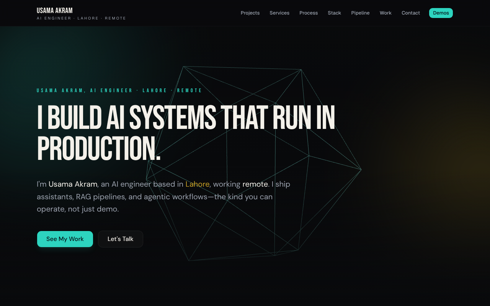
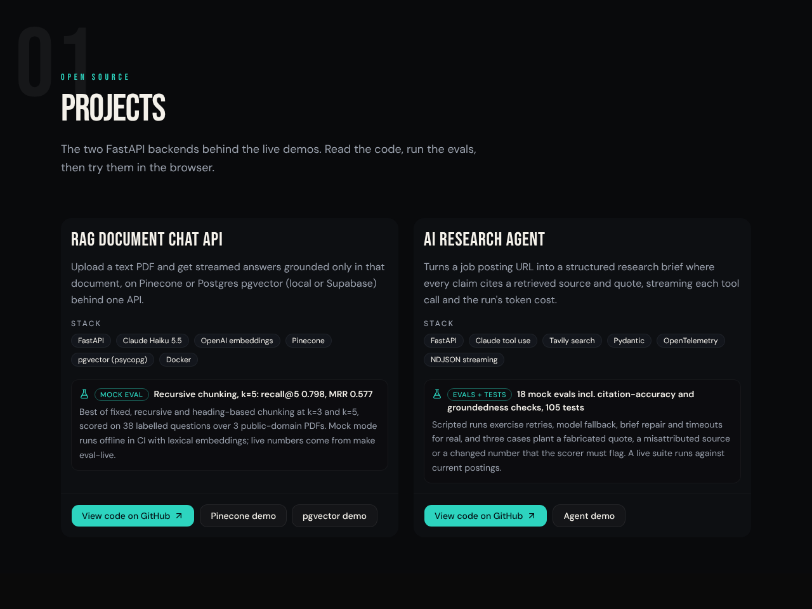
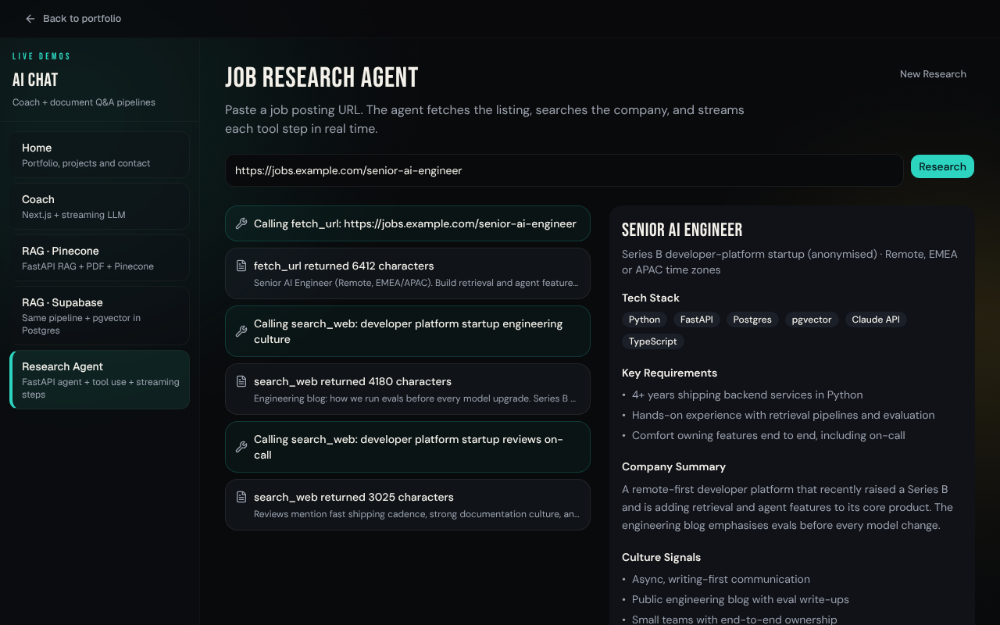
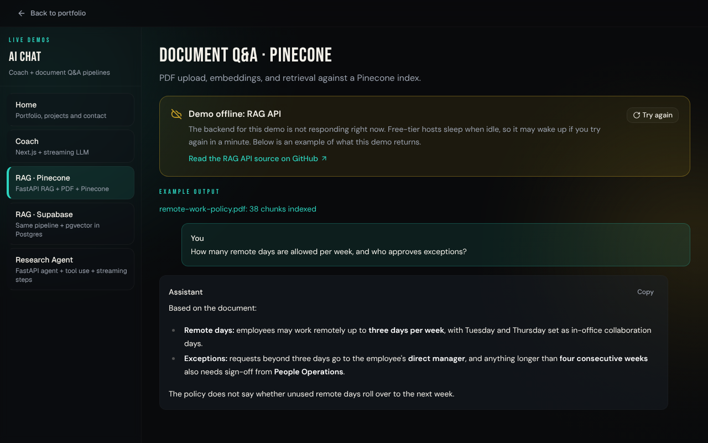
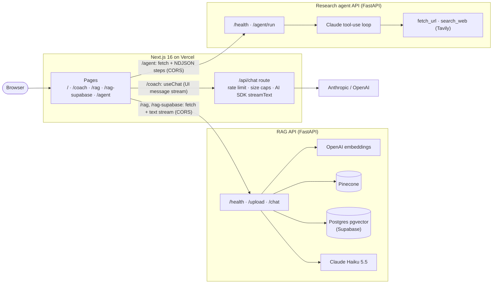

# Usama Akram · AI Engineer

[](https://github.com/uusammmaa/ai-engineer-portfolio/actions/workflows/ci.yml)


Portfolio site with four live AI demos: a streaming Claude coach, retrieval-augmented document Q&A on two vector stores (Pinecone and Supabase pgvector), and a tool-using research agent. The frontend is Next.js 16 on Vercel; the RAG and agent demos call two open-source FastAPI backends:

| Backend | What it does | Eval headline |
| --- | --- | --- |
| [rag-api-pgvector-pinecone](https://github.com/uusammmaa/rag-api-pgvector-pinecone) | Upload a text PDF, get streamed answers grounded only in that document, on Pinecone or pgvector behind one API. | Mock eval, recursive chunking, k=5: recall@5 0.798, MRR 0.577 |
| [ai-research-agent](https://github.com/uusammmaa/ai-research-agent) | Turns a job posting URL into a research brief where every claim cites a retrieved source and quote, streaming each tool call and the run's cost. | 18 mock evals incl. citation-accuracy and groundedness checks, 105 tests |

## Screenshots

| Landing page | Projects |
| --- | --- |
|  |  |
| **Research agent (sample run)** | **Demo offline fallback** |
|  |  |

## Demos

| Route | Demo | Talks to |
| --- | --- | --- |
| `/` | Landing page, projects, contact | |
| `/coach` | Streaming career coach (Claude Haiku 4.5 or GPT-5 mini) | `POST /api/chat` in this app |
| `/rag` | PDF upload and Q&A, vectors in Pinecone | RAG API `/upload`, `/chat` |
| `/rag-supabase` | Same pipeline, vectors in Postgres via pgvector | RAG API with `vector_store=supabase` |
| `/agent` | Job posting research agent: live tool steps, cited claims, run cost | Agent API `/agent/run` (NDJSON stream) |

## Architecture



- **Coach** stays inside this app: `useChat` posts the thread to `/api/chat`, which streams back an AI SDK UI message stream. API keys never reach the browser.
- **RAG and agent demos** call the FastAPI services directly from the browser, so each backend must allow this site's origin in CORS (see [Deploy](#deploy-to-vercel)). Upload returns a `doc_id`; every question is scoped to that document's top 5 chunks. Upload errors come back as `{ "error": { "code", "message" } }`: a non-PDF (415) and a password-protected, scanned or unparseable PDF (422) are shown inline with the API's explanation.
- **Agent stream:** each NDJSON line is a step (`tool_call`, `tool_result`, `repair`, `complete`, `error`). The brief carries `claims` (statement, source URL, verbatim quote), rendered with links to their sources, and the last line is a `run_summary` with tokens and cost per model, shown as the run cost. A job URL that is not http(s) gets a 422, shown under the input.
- **Resilience:** before showing a demo, the page probes its backend (`GET /health` for FastAPI, `GET /api/chat` for the coach, 10 s timeout). If the URL is unset, the probe fails, or a request later fails at the network level, the demo switches to a "Demo offline" banner with a retry button, a link to the backend's source, and an example of the output (`lib/demo-recordings.ts`).

### `/api/chat` limits

| Guard | Default | Response |
| --- | --- | --- |
| Rate limit per client (IP) | 10 requests / minute (`CHAT_RATE_LIMIT`) | `429` + `Retry-After` |
| Request body | 64 KB | `413` |
| Single user message | 2,000 characters (also enforced in the composer) | `413` |
| History sent to the model | last 20 messages | trimmed silently |
| Model without an API key | | `503` with `code: "offline"` |

The limiter is in memory, so each warm serverless instance keeps its own counters. That is enough to stop casual abuse of a public demo; move it to a shared store such as Redis if you need a hard global cap.

## Local setup

Requires Node.js 20.9 or newer. The lockfile is `package-lock.json`, so use npm.

```bash
npm ci
cp .env.example .env.local   # then fill in the values below
npm run dev                  # http://localhost:3000
```

### Environment variables

| Variable | Used by | Notes |
| --- | --- | --- |
| `ANTHROPIC_API_KEY` | `/api/chat` (server) | Enables Claude Haiku 4.5 in the coach. |
| `OPEN_AI_API_KEY` | `/api/chat` (server) | Enables GPT-5 mini in the coach. With neither key the coach shows its offline state. |
| `CHAT_RATE_LIMIT` | `/api/chat` (server) | Optional. Requests per client per minute, default 10. |
| `NEXT_PUBLIC_API_URL` | `/rag`, `/rag-supabase` (browser) | RAG API origin. Inlined at build time. In `npm run dev` it falls back to `http://localhost:8000`; in a production build, unset means the demo shows its offline state. |
| `NEXT_PUBLIC_AGENT_API_URL` | `/agent` (browser) | Agent API origin. Falls back to `NEXT_PUBLIC_API_URL`. |
| `NEXT_PUBLIC_SITE_URL` | metadata, sitemap, OG | Canonical site URL, e.g. `https://your-domain.com`. |
| `NEXT_PUBLIC_CONTACT_EMAIL` | contact CTA | Optional. |
| `NEXT_PUBLIC_MUX_PLAYBACK_ID` | landing page | Optional featured video. |

### Running the backends locally

Follow each repo's README, then point the frontend at them:

```bash
# RAG API: http://localhost:8000 (CORS_ORIGINS defaults to http://localhost:3000)
uvicorn app.main:app --reload --port 8000

# Research agent API: http://localhost:8010 (set CORS_ORIGINS to include http://localhost:3000)
uvicorn main:app --reload --port 8010
```

## Scripts

| Command | What it does |
| --- | --- |
| `npm run dev` | Development server |
| `npm run build` / `npm start` | Production build and server |
| `npm run lint` | ESLint, zero warnings allowed |
| `npm run typecheck` | `next typegen` then `tsc --noEmit` |
| `npm run test:e2e` | Builds with test backend URLs, starts the app, runs Playwright |

## Testing and CI

`e2e/` holds 27 Playwright tests run against a production build:

- **Every route:** each demo renders its offline state and example when its backend is unreachable, and its happy path works when the backend is mocked (coach streaming reply, RAG upload and answer, agent steps with a repair, cited claims and run cost, mid-session failure).
- **Backend errors:** RAG uploads rejected with 415 (not a PDF) and 422 (password-protected) show the API's message inline; the agent's 422 for a non-http(s) job URL is shown under the input, and its 503 switches the demo offline.
- **API:** `/api/chat` returns 400, 413, 429 and 503 where it should.
- **SEO:** title, description, canonical, Open Graph and Twitter tags, OG image, sitemap and robots.
- **Accessibility:** axe-core (WCAG 2.1 A and AA) on all five pages fails the build on any serious or critical violation; skip link and mobile menu are checked by keyboard.

The e2e build points both demo backends at a closed local port (`http://127.0.0.1:9`), so tests never depend on a live service. To run them locally:

```bash
npx playwright install chromium   # once
npm run test:e2e
```

[GitHub Actions](.github/workflows/ci.yml) runs lint, typecheck, build and the smoke tests on every pull request and on pushes to `master`, and uploads the Playwright report when something fails.

## Deploy to Vercel

1. Import the repository in Vercel. The framework preset (Next.js) and default build command work as is; Node 20.9+ is required.
2. Add environment variables for Production and Preview:
   - `ANTHROPIC_API_KEY` and/or `OPEN_AI_API_KEY`
   - `NEXT_PUBLIC_SITE_URL` set to the production URL
   - `NEXT_PUBLIC_API_URL` and `NEXT_PUBLIC_AGENT_API_URL` set to the deployed FastAPI services (HTTPS)
3. **Add the Vercel domain to both backends' CORS allowlists.** The browser calls the FastAPI services directly, so without this the RAG and agent demos fail their health check and show the offline state. Both read `CORS_ORIGINS` (comma separated, default `http://localhost:3000`), for example `CORS_ORIGINS=https://your-domain.com,https://your-project.vercel.app`. Include any preview domain you want the demos to work on.
4. Redeploy after changing any `NEXT_PUBLIC_*` value: they are inlined at build time.
5. If a backend is not deployed yet, leave its URL unset. The matching demo shows the offline state with example output instead of erroring.

Free-tier hosts that sleep when idle are fine: the first visitor sees "Demo offline" with a **Try again** button, and the health probe itself wakes the service.

## Project layout

| Path | Role |
| --- | --- |
| `app/(marketing)/` | Landing page and Person JSON-LD |
| `app/(demo)/` | Demo routes inside the shared demo shell |
| `app/api/chat/route.ts` | Coach API: limits, model selection, streaming |
| `app/opengraph-image.tsx`, `icon.tsx`, `sitemap.ts`, `robots.ts` | Generated metadata files |
| `components/landing/` | Landing sections, including `projects.tsx` |
| `components/*Panel.tsx`, `DemoOffline.tsx` | Demo UIs and the shared offline state |
| `lib/backends.ts` | Backend origins and repo links |
| `lib/use-service-status.ts` | Health probe hook used by every demo |
| `lib/demo-recordings.ts` | Example outputs shown when a demo is offline |
| `lib/projects.ts` | Project cards: outcome, stack, eval headline |
| `lib/rate-limit.ts`, `lib/chat-limits.ts` | `/api/chat` guards shared with the UI |
| `e2e/`, `playwright.config.ts` | Smoke, API and accessibility tests |
